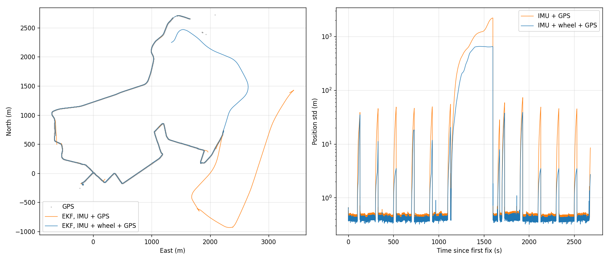

# 2D Extended Kalman Filter for GPS / IMU / Wheel-Speed Localization (C++)

A C++17 implementation of a 2D Extended Kalman Filter that fuses a 200 Hz IMU, 10 Hz GPS and 50 Hz wheel speed to localize a car. The filter runs offline on a 51-minute ROS 2 bag recorded on a Lincoln MKZ (Dataspeed drive-by-wire kit). Linear algebra is done with Eigen.

The project is a port of an earlier Python implementation. The C++ version reproduces the Python results to the reported precision, then adds wheel-speed fusion, which cuts dead-reckoning drift during 30 s GPS outages by about 20x.



*Left: GPS (grey), the EKF with IMU + GPS (orange) and with IMU + wheel speed + GPS (blue). The large excursion on the right is a real 7.7-minute GPS outage. Right: 1-sigma position uncertainty over time; the regular spikes are simulated 30 s GPS outages used for evaluation.*

## Results

All errors are in meters. GPS points used for scoring are never given to the filter (see [Evaluation](#evaluation)).

| Metric | IMU + GPS | IMU + wheel + GPS |
|---|---|---|
| Held-out RMSE | **0.18** | 0.54 |
| Held-out 95th percentile | 0.28 | **0.27** |
| Drift after a simulated 30 s outage (median) | 68.83 | **3.32** |
| Drift after a simulated 30 s outage (mean) | 83.06 | **7.65** |
| Error after the real 462 s GPS outage | 2123.93 | **516.00** |
| Mean NIS (ideal: 2) | 0.09 | 0.14 |
| GPS fixes rejected by the gate / recoveries | 40 / 2 | 76 / 8 |

How to read this:

- **Wheel speed fixes dead reckoning.** Without it, speed comes from integrating the accelerometer, and any acceleration error grows into position error quadratically. With speed measured directly, 30 s outage drift drops from about 69 m to about 3 m.
- **Held-out RMSE is higher with wheel speed, and this is mostly a scoring artifact.** The held-out score treats GPS as the truth. About 31 held-out points sit next to GPS glitches (for example, fixes jumping 35 to 42 m just before the long outage). With wheel speed the filter is confident enough to reject those jumps, so it gets "penalized" for not following them. Excluding those points, both configurations score about the same, and the median error improves from 0.13 m to 0.08 m.
- **The filter is conservative.** Mean NIS is well below 2, so the assumed noise levels are larger than the real ones. There is room to tune `R` and `Q` down.
- **The remaining long-outage error is mostly heading drift.** Over 7.7 minutes without GPS, the gyro bias integrates into heading error, which wheel speed cannot correct.
- **The reference is GPS, not ground truth.** Sub-meter numbers show the filter tracks GPS closely; they are not a claim of sub-meter absolute accuracy.

## Dataset

| Topic | Rate | Used for |
|---|---|---|
| `/imu/imu_uncompensated` | 200 Hz | forward acceleration (`linear_acceleration.x`) and yaw rate (`angular_velocity.z`) |
| `/gps/fix` | 10 Hz | position (latitude / longitude) |
| `/vehicle/twist` | 50 Hz | wheel speed (`twist.linear.x`) |

The bag holds 616,322 IMU samples, 30,758 GPS fixes and 153,852 wheel-speed messages. The bag itself is not included in this repository.

## Method

### Data preparation

**GPS** (30,758 fixes, 21,831 usable):

1. Drop fixes without a solution (8,887 rows of `NaN`, mostly the first 274 s before the receiver locks).
2. Convert latitude / longitude to UTM meters (WGS84, Transverse Mercator series; zone 19 for Boston). The C++ conversion matches the Python reference to 0.1 mm.
3. Drop "teleports": fixes that imply more than 40 m/s from the previous one (40 removed).
4. Shift everything so the first usable fix is (0, 0).

**IMU:**

1. Flip the sign of the gyro z axis. The IMU is mounted z-down, and the filter measures heading counter-clockwise from east.
2. Estimate accelerometer and gyro biases as the mean over the first 2 s, while the car is parked (401 samples), and subtract them.

**Initial state:**

- Position: the first usable fix, (0, 0).
- Heading: the direction to the first fix more than 15 m away. Closer fixes are dominated by GPS noise.
- Speed: distance to the 6th fix divided by its elapsed time (3.95 m/s).

### Filter

State: `x = [px, py, theta, v, b_a]` (position, heading, speed, accelerometer bias).

**Predict** (every IMU sample, `dt` capped at 50 ms), using a unicycle model driven by the IMU:

```
px    += v cos(theta) dt
py    += v sin(theta) dt
theta  = wrap(theta + omega dt)
v     += (a - b_a) dt
P      = F P F^T + Qc dt
```

`F` is the analytic Jacobian. Process noise is specified per second (`Qc dt`), so tuning does not depend on the IMU rate.

**GPS update** (position, `H = [I2 0]`, R = 0.25 m^2):

- Joseph-form covariance update, `P = (I - KH) P (I - KH)^T + K R K^T`, which keeps `P` symmetric and positive definite.
- **Chi-square gating:** a fix is rejected if its normalized innovation squared, `y^T S^-1 y`, exceeds 9.21 (99% for 2 degrees of freedom).
- **Recovery:** after 10 consecutive rejections (1 s), the filter assumes it has drifted rather than the GPS. It inflates the position covariance by the innovation and accepts the fix. Without this, the filter can reject GPS indefinitely after a long outage.

**Wheel-speed update** (`H = [0 0 0 1 0]`, R = 0.04 (m/s)^2): the same steps with a scalar innovation, so `S` is a plain number and no matrix inverse is needed.

The three sensor streams are merged by timestamp. For each IMU sample, the filter predicts, then applies every wheel-speed and GPS message whose timestamp has been reached. The run stops once the last GPS fix has been applied.

### Evaluation

Scoring follows the original Python notebook so that the two implementations can be compared:

- **Held-out:** every 10th usable GPS point (starting at index 5) is never given to the filter. The distance between the filter's prediction and that point is the held-out error.
- **Simulated outages:** 30 s windows every 200 s, used only where GPS coverage is good, are hidden entirely. The error at the end of each window measures dead-reckoning drift.
- Points within 5 s after a real GPS gap are excluded from the RMSE, since the filter is still recovering there.

## Building and running

Requirements: CMake 3.16 or newer, a C++17 compiler (tested with GCC 12 and 13), Eigen 3. ROS 2 (tested on Jazzy) is needed only to export the bag to CSV, and matplotlib only for plotting.

```bash
# 1. Export the bag to CSV (writes data/gps.csv, data/imu.csv, data/wheel.csv)
source /opt/ros/jazzy/setup.bash
python3 tools/export_csv.py path/to/my_ros2_bag_data.db3

# 2. Build
cmake -S . -B build -DCMAKE_BUILD_TYPE=Release
cmake --build build

# 3. Run, with and without wheel speed (writes output/*.csv and prints the score table)
./build/ekf
./build/ekf --no-wheel

# 4. Plot (writes output/trajectory.png)
python3 tools/plot_trajectory.py
```

Run the binary from the project root, because the data paths are relative to it. The full run takes about 0.5 s in Release.

## Repository layout

```
CMakeLists.txt
main.cpp                 data pipeline, filter loop, scoring, output
include/ , src/
  data.*                 CSV loading (IMU, GPS, wheel), NaN removal, IMU preparation
  utm.*                  lat/lon -> UTM, teleport removal, shift to the first fix
  ekf2d.*                the filter: predict, GPS update with gating, wheel-speed update
  evaluation.*           held-out and outage masks, score table
  output.*               CSV writers for plotting
tools/
  export_csv.py          ROS 2 bag -> CSV
  plot_trajectory.py     plots the output
docs/trajectory.png
```

## Debugging log

These are the problems hit while building the C++ version, in roughly the order they appeared. Each lists the symptom, the cause and the fix.

### Build system and toolchain

**1. CMake warning "No project() command is present" and "ninja: no work to do".**
The source files existed but were empty, because they hadn't been saved in the editor. CMake was reading an empty `CMakeLists.txt`. Fixed by saving (and turning on auto-save). Building a minimal program first, a 5x5 Eigen identity matrix, made this easy to separate from any code problem.

**2. `fatal error: Eigen/Dense: No such file or directory`.**
The editor's "Run C/C++ File" button calls `g++` directly on one file and ignores `CMakeLists.txt`. On Ubuntu, Eigen's headers live in `/usr/include/eigen3`, which isn't on the default search path. Through CMake, `target_link_libraries(ekf PRIVATE Eigen3::Eigen)` adds `-isystem /usr/include/eigen3` (confirmed in `compile_commands.json`). Fixed by always building through CMake.

**3. `The source directory ".../cpp_ekf/cpp_ekf" does not exist` and `does not appear to contain CMakeLists.txt`.**
Relative paths were resolved from the wrong working directory. Fixed by running from the project root, with `cmake -S . -B build`.

**4. Code changes had no effect.**
A stale binary was being run: either a manually compiled `./main` left over from step 2, or a binary not rebuilt after an edit. Fixed by deleting the manual binary and always running `cmake --build build && ./build/ekf`.

**5. Different compilers and build types in different folders.**
The editor's CMake integration configured `build/` with GCC 12 in Debug, which silently replaced an earlier Release configuration. Kept separate `build/` (Debug, editor) and `build-release/` (Release) folders, since each build folder remembers its own compiler and build type.

### C++ language errors

**6. `'data.hpp': No such file or directory`, then an expected linker error.**
After splitting code into `include/` and `src/`, the include directory wasn't registered and the new `.cpp` wasn't compiled. Fixed with `target_include_directories(ekf PRIVATE include)` and by adding each new source file to `add_executable`. Missing include paths are compiler errors; a missing source file is a linker error (`undefined reference`).

**7. `'makeRelative' was not declared in this scope` and `no declaration matches 'void Ekf2D::predict(...)'`.**
Function bodies were written in the `.cpp` without a matching declaration in the header (or inside the class). Every function needs a declaration that other files can see and exactly one definition.

**8. `no matching function for call to 'Ekf2D::update(Vec5&)'`.**
The declaration (`update(double, double)`), the definition (`update(const Vec5&)`) and the call site disagreed. A GPS fix is 2 numbers, not 5, so all three were aligned on `update(double east, double north)`.

**9. `'gpsFixes' was not declared in this scope` and `expected 'catch' before ...`.**
New code was placed between the `try { }` block and its `catch`. That is illegal, because `catch` must follow `try` directly, and the variables declared inside `try` were out of scope there. Fixed by moving the code inside the `try` block.

**10. `no match for 'operator<<'` when printing a custom struct.**
`std::ostream` doesn't know how to print user types. Fixed by overloading `std::ostream& operator<<(std::ostream&, const T&)` and returning the stream, so output can be chained.

**11. `terminate called after throwing an instance of 'std::runtime_error'` (core dumped).**
The loader correctly threw on a missing file, but nothing caught the exception. Fixed by wrapping `main` in `try { ... } catch (const std::exception& e)`, printing the message and returning a non-zero exit code.

### Data parsing

**12. `Failed to parse line: 1697739278.741994143,-0.504...`.**
`stream >> double` stops at the first comma, and the next extraction fails. A first attempt put `','` on the outer `getline(file, line, ',')`, which split the file into single fields instead of lines. Fixed with two levels of splitting: `getline(file, line)` for rows, and `getline(ss, field, ',')` plus `std::stod` for fields.

**13. GPS rows containing `nan`.**
8,887 GPS rows have `nan` coordinates (no fix). `operator>>` cannot parse `"nan"`, but `std::stod` can, so switching to `std::stod` fixed both this and item 12. The NaN fixes are then removed with `std::isnan`.

**14. Timestamps printed as `1.69774e+09`.**
The default stream precision is 6 significant digits, which hides the fractional seconds that `dt` depends on. Fixed with `std::fixed << std::setprecision(6)`. (The timestamps are stored as `double`, which resolves about 0.2 microseconds at this magnitude; a `float` would only resolve about 2 minutes.)

**15. A misleading performance measurement.**
The first timing showed 5.7 s to load the 86 MB IMU file, which suggested a slow parser. Repeated runs took 0.5 s; the first measurement was taken while the editor was indexing the project. Lesson: repeat a timing before acting on it.

### Numerical bugs

**16. UTM easting / northing off by a factor of about a million.**
Found by printing every intermediate value and comparing it with the Python reference. The first mismatch pinpoints the bug. Three bugs were found this way:

- The zone's central meridian used pi/3 per zone instead of 6 degrees (pi/30).
- `lon0` was computed from `zone` before `zone` was assigned, so it used the default value 0 and gave -183 degrees.
- The `cos(lat)` factor was missing from `A = (lon - lon0) cos(lat)`.

A fourth, smaller discrepancy followed when introducing `ep2 = e2 / (1 - e2)`: `ep2` was first substituted into the wrong terms (`N` and `C`), which the intermediate values exposed immediately. After the fixes, the result matches Python to 0.1 mm.

**17. `predict` appeared correct but was missing three Jacobian entries, the heading wrap and the bias term.**
The first test used `theta = 0` and `v = 0`, which zeroes out exactly the terms that were missing (`-v sin(theta) dt`, and so on). Retesting with non-zero inputs (`theta = 0.5`, `v = 10`) against a one-step Python reference exposed all five differences. Lesson: zeros make bad test inputs.

**18. `YOU_MIXED_MATRICES_OF_DIFFERENT_SIZES` (Eigen static assertion).**
The first GPS update added a 2x2 `R` to the 5x5 `P` directly. With fixed-size Eigen types, the compiler caught it. Fixed by introducing the 2x5 measurement matrix `H`, so `S = H P H^T + R` is 2x2 and `K` is 5x2. To find the cause in a long Eigen error, search for `YOU_` and for your own file and line numbers.

### Filter behaviour

**19. The trajectory continued for 130 s after the last GPS fix, then stopped one fix too early.**
The main loop originally ran until the IMU data ended, which added a long stretch of pure dead reckoning. The first fix compared timestamps at the top of the loop and stopped on exactly the IMU sample where the last fix was due (21,830 of 21,831 fixes used). The final fix stops after the GPS updates, once every fix has been processed.

**20. Negative speed for 38% of the run.**
The same happens in the Python reference (38.6%, starting at the same time), so it is a model property, not a porting bug. The first hypothesis was the heading/speed ambiguity, where `(theta, v)` and `(theta + pi, -v)` produce identical positions. The data rejected it: heading disagreed with the GPS course by more than 90 degrees only 0.1% of the time. The actual causes were:

- noise around zero while stopped (about 23% of samples, harmless), and
- speed drifting through zero during GPS gaps (98% of the clearly negative samples), because accelerometer error (largely a few degrees of mount pitch leaking gravity into the forward axis) integrates unchecked.

Forcing `v >= 0`, by clamping or by flipping to the equivalent forward state, made the long-outage error worse (about 2,100 m to about 3,400 m), so it was reverted. The root-cause fix was measuring speed directly: with wheel-speed fusion, speed no longer drifts negative and outage drift drops by about 20x.

**21. Small differences from the Python numbers (held-out RMSE 0.18 vs 0.17; 40 vs 43 gated fixes).**
The C++ teleport filter compares consecutive fixes after NaN removal, while the Python version doesn't compare across NaN gaps. So the C++ version removes 40 fixes instead of 38, which shifts which points fall into the every-10th held-out set. All other metrics match to the reported precision.

**22. Isolated GPS fixes rejected after long gaps.**
After a long outage, a single valid fix can fail the chi-square gate because the filter has drifted far. Recovery only triggers after 10 consecutive rejections, so isolated fixes are discarded. This is a known trade-off of innovation gating. A possible improvement is to relax the gate when position uncertainty is already large.

## Limitations and possible improvements

- Wheel speed reads about 1.4% lower than GPS-derived speed and is not calibrated. A fixed scale factor or a scale state would address this.
- Heading drift dominates long outages. The wheel yaw rate in `/vehicle/twist` could be fused as a second turn-rate source.
- Mean NIS is well below 2, so the noise parameters are conservative and could be retuned.
- The 2D model ignores pitch and roll. A full 6-DoF strapdown filter, with gravity leveling and a non-holonomic constraint, handles the mount pitch properly.
- The filter runs offline on CSV. Wrapping it as a ROS 2 node would let it run live on the bag.
